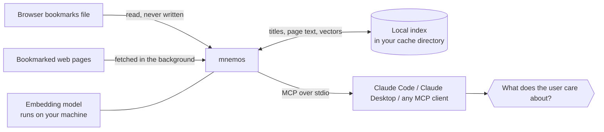

<div align="center">

# 🧠 mnemos

**Your bookmarks are a map of what you value. Let your AI read the map.**

*mnemos* (from the Greek **μνήμη** — memory) is a local
[MCP](https://modelcontextprotocol.io) server that gives AI assistants access to your
browser bookmarks (Chrome, Edge, Brave, Vivaldi, Chromium, Firefox or Safari) — not as a pile of links, but as a curated signal of what you
consider important, which sources you trust, and which opinions you endorse.
It finds them by keyword, or by meaning: a local embedding model searches their
titles and the text of the pages they point to, in any language.

[](https://www.npmjs.com/package/mnemos-mcp)
[](https://github.com/noesis-sol/mnemos/actions/workflows/ci.yml)
[](https://nodejs.org)
[](https://modelcontextprotocol.io)
[](#privacy--design)
[](#privacy--design)

</div>

---

## Why

Every bookmark is a deliberate act: *this mattered enough to keep.* Folder names
are your personal taxonomy. Frequently bookmarked domains are your trusted
sources. Recent additions are what you're thinking about *right now*.

mnemos hands that context to your AI assistant, so instead of generic answers you get:

> *"Based on your bookmarks, you've been deep in agentic engineering lately —
> here's how this connects to the LiveKit material you saved…"*

## How it works



The keyword tools read your browser's bookmarks directly from disk on every
call — always fresh, no sync. Chromium-based browsers keep a `Bookmarks`
JSON file; Firefox keeps a `places.sqlite` database, which it locks while it runs,
so mnemos copies it to a temporary directory, reads the copy and keeps the result
in memory until the database changes; Safari keeps a binary `Bookmarks.plist`.
mnemos never writes to any of them. It speaks MCP over stdio, so it works with
any MCP client.

`semantic_search` reads a local index that mnemos builds in the background,
after it has answered the client's handshake, so it never holds your client up:

1. **Titles.** Each bookmark's title, description, folder path and URL words
   are embedded by a multilingual model
   ([multilingual-e5-small](https://huggingface.co/Xenova/multilingual-e5-small))
   running on your machine. Only new or changed bookmarks are embedded again,
   when the bookmarks file changes.
2. **Pages.** Then mnemos fetches the pages you bookmarked, keeps their
   readable text, cuts it into passages and embeds those too (see
   [Page fetching](#page-fetching)).

The index is one SQLite file per bookmarks file, in mnemos's
[cache directory](#cache). Until the model is ready, `semantic_search` answers
with keyword matches and says why; its `status` reports how far indexing has
got.

## Tools

| Tool | What it tells your assistant |
|------|------------------------------|
| 🔍 `search_bookmarks(query, folder?, limit?)` | Has the user saved material on this topic? Every query word must match the title, URL, folder path or description, at the start of a word — `kubernet` finds *Kubernetes*, `ai` doesn't match *Gmail*. |
| 🧭 `semantic_search(query, folder?, limit?)` | Has the user saved material *about* this, whatever the wording or language? Ranks bookmarks by meaning, over their titles and the text of their pages, with exact keyword matches always first. Each result says whether it `matched_on` its title, its page (with a `snippet`) or a keyword. |
| 🗂 `list_folders()` | The user's own taxonomy of interests — every folder, with direct and subtree counts. |
| 📁 `list_folder_contents(folder, limit?)` | Everything saved under a topic (whole-word folder matching, subfolders included). |
| 🕐 `recent_bookmarks(limit?)` | What the user is focused on right now, newest first. |
| 🌐 `top_domains(limit?)` | The sources the user trusts and returns to, ranked by bookmark count. |

Bookmarks carry a `description` where the browser stores one: Vivaldi's bookmark
descriptions, Firefox's (the one typed in older Firefox's bookmark dialog, else the
page's own description Firefox saved), and the preview text of Safari's Reading List.

Every tool that can truncate reports a `total_matches` count (`semantic_search`:
`count_above_threshold`), so the assistant always knows when it is looking at a
partial list. Defaults return up to 100 items (hard cap 200; `top_domains`
defaults to 25, cap 100; `semantic_search` returns only results above a
relevance cutoff, 20 by default, cap 100).

## Quick start

Requires Node 22.13+ (macOS, Windows, or Linux). No clone, no setup — `npx` fetches and runs it:

**Claude Code**

```sh
claude mcp add --scope user mnemos -- npx -y mnemos-mcp
```

**Claude Desktop** — add to `~/Library/Application Support/Claude/claude_desktop_config.json`:

```json
{
  "mcpServers": {
    "mnemos": {
      "command": "npx",
      "args": ["-y", "mnemos-mcp"]
    }
  }
}
```

Then ask things like:

- *"Based on my bookmarks, what am I currently interested in?"*
- *"Have I saved anything about MCP servers?"*
- *"Did I bookmark anything on how to keep sourdough starter alive?"*
- *"Which sources do I trust for finance?"*

### The first start

The package itself is small: mnemos and its dependencies, plus two optional
ones, playwright-core (about 13 MB, to [render JavaScript-only pages](#page-fetching)
in a browser you already have) and unpdf (about 2.5 MB, to read bookmarked
PDFs). The keyword tools work as soon as your client has started it.

Semantic search runs the model through
[`@huggingface/transformers`](https://www.npmjs.com/package/@huggingface/transformers),
which with ONNX Runtime weighs about 490 MB. So that `npx` starts mnemos within
your MCP client's start timeout, it is not part of the package. On the first
start, after connecting, mnemos:

1. installs it with npm (your npm configuration: registry, proxy, cache) into
   `runtime/` in its [cache directory](#cache) — about 490 MB, once;
2. downloads the model, about 135 MB, from Hugging Face into `models/` there —
   once, at a pinned revision; after that the model loads offline;
3. embeds your bookmark titles, then starts fetching pages.

Until the runtime and model are there, `semantic_search` matches keywords and
its `status` says what it is waiting for. Set `MNEMOS_INSTALL_RUNTIME=0` to
skip the install (for instance where npm cannot reach the registry);
`semantic_search` then stays keyword-only.

## Configuration

| Environment variable | Default | Purpose |
|----------------------|---------|---------|
| `MNEMOS_BOOKMARKS_BROWSER` | `chrome` | Browser to read: `chrome`, `chromium`, `edge`, `brave`, `vivaldi`, `firefox` or `safari` |
| `CHROME_PROFILE` | `Default` | Profile directory name (e.g. `Profile 3`); for Firefox, the profile's name (default: the one Firefox opens) |
| `CHROME_BOOKMARKS_PATH` | — | Absolute path to any supported bookmarks file (`Bookmarks`, `places.sqlite` or `Bookmarks.plist`); overrides the two above |
| `MNEMOS_CACHE_DIR` | your OS cache directory | Where mnemos keeps its index, model and embedding runtime (see [Cache](#cache)) |
| `MNEMOS_INSTALL_RUNTIME` | — | `0` keeps mnemos from installing its embedding runtime on first start; `semantic_search` then matches keywords only |
| `MNEMOS_FETCH_PAGES` | — | `0` turns off fetching bookmarked pages; `semantic_search` then uses titles only |
| `MNEMOS_SKIP_DOMAINS` | — | Comma-separated domains never fetched; each also covers its subdomains |
| `MNEMOS_SKIP_FOLDERS` | — | Comma-separated folder names (whole-word, like `list_folder_contents`) whose pages are never fetched; their titles are still searchable |
| `MNEMOS_FETCH_ALLOW_HOSTS` | — | Comma-separated `host` or `host:port` exempt from the private-address block, e.g. an intranet wiki |
| `MNEMOS_BROWSER` | an installed Chrome, Edge, Chromium or Brave | Path to a Chromium-based browser for pages that need JavaScript; `0` turns this off |

For example, `claude mcp add --scope user mnemos -e MNEMOS_BOOKMARKS_BROWSER=firefox -- npx -y mnemos-mcp`.

> Chrome profiles live in `~/Library/Application Support/Google/Chrome` (macOS),
> `%LOCALAPPDATA%\Google\Chrome\User Data` (Windows), and
> `~/.config/google-chrome` (Linux). Directory names are `Default`,
> `Profile 1`, `Profile 2`, … — **not** the display names you see in
> Chrome's UI.

| Browser | macOS | Windows | Linux |
|---------|-------|---------|-------|
| Edge | `~/Library/Application Support/Microsoft Edge` | `%LOCALAPPDATA%\Microsoft\Edge\User Data` | `~/.config/microsoft-edge` |
| Brave | `~/Library/Application Support/BraveSoftware/Brave-Browser` | `%LOCALAPPDATA%\BraveSoftware\Brave-Browser\User Data` | `~/.config/BraveSoftware/Brave-Browser` |
| Vivaldi | `~/Library/Application Support/Vivaldi` | `%LOCALAPPDATA%\Vivaldi\User Data` | `~/.config/vivaldi` |
| Chromium | `~/Library/Application Support/Chromium` | `%LOCALAPPDATA%\Chromium\User Data` | `~/.config/chromium` |
| Firefox | `~/Library/Application Support/Firefox` | `%APPDATA%\Mozilla\Firefox` | `~/.mozilla/firefox`, `~/.config/mozilla/firefox`, Snap or Flatpak |
| Safari | `~/Library/Safari/Bookmarks.plist` | — | — |

> **Node 22.13** is the floor: mnemos keeps its index with `node:sqlite`, and
> reads Firefox's `places.sqlite` with it too. Firefox profiles are those
> listed in `profiles.ini`.
>
> **Safari**: macOS lets only apps with *Full Disk Access* read Safari's
> bookmarks. Add the app that runs mnemos — your terminal for Claude Code, or
> Claude Desktop — in System Settings › Privacy & Security › Full Disk Access.

If the profile has no bookmarks file, mnemos tells the assistant which profiles
do — no cryptic tracebacks.

### Cache

mnemos keeps everything it builds in one directory, `MNEMOS_CACHE_DIR` when it
is set, else:

| macOS | Windows | Linux |
|-------|---------|-------|
| `~/Library/Caches/mnemos` | `%LOCALAPPDATA%\mnemos\Cache` | `$XDG_CACHE_HOME/mnemos`, else `~/.cache/mnemos` |

In it:

- `index-<hash>.sqlite` — the index of one bookmarks file: title vectors, each
  page's fetch state and readable text, and its passages' vectors. It grows
  with your library and the pages' text.
- `models/` — the embedding model (about 135 MB).
- `runtime/` — the embedding runtime (about 490 MB). Each mnemos version that
  upgrades the runtime installs it beside the old one; a runtime no mnemos has
  loaded for 30 days is removed.

All of it is a cache: everything in it can be rebuilt from your bookmarks and
the web. To delete it, quit the MCP clients that run mnemos and remove the
directory, e.g. `rm -rf ~/Library/Caches/mnemos`. The next start installs,
downloads and indexes again; set `MNEMOS_INSTALL_RUNTIME=0` and
`MNEMOS_FETCH_PAGES=0` first if you do not want that.

### Page fetching

For semantic search over page contents, mnemos fetches the pages you
bookmarked in the background, after it has indexed their titles, and keeps
their readable text (extracted with Mozilla's Readability; a PDF's with pdf.js)
in its local index ([`src/fetcher.ts`](src/fetcher.ts)). The first
`semantic_search` answer after it starts says so once. New bookmarks go first,
newest first, at most 4 fetches at a time, one at a time per site with a second
between them. When several MCP clients each run mnemos, only one of them
fetches. Set `MNEMOS_FETCH_PAGES=0` to turn all of it off.

The index stays fresh on its own:

- A page that was read is fetched again 30 days later, and embedded again only
  if its text changed.
- A page that fails (or whose site refuses) is retried after 1 hour, 6 hours,
  1 day, 7 days, then every 30 days.
- A page behind a login, or one the policy below skipped on the way (a
  redirect to a skipped domain or a private address), is tried again after
  30 days, or at once when `MNEMOS_SKIP_DOMAINS`, `MNEMOS_SKIP_FOLDERS` or
  `MNEMOS_FETCH_ALLOW_HOSTS` change.
- A page with no text even in a browser (or a PDF with none: a scan; there is
  no OCR) is not fetched again.
- When you delete a bookmark, its page and passages leave the index; when a
  page comes under `MNEMOS_SKIP_DOMAINS` or `MNEMOS_SKIP_FOLDERS` (the list
  edited, or the bookmark moved into a skipped folder), its text and passages
  do too.

A page that needs JavaScript to show anything is loaded again in a headless
browser you already have — Chrome, Edge, Chromium or Brave, or the one
`MNEMOS_BROWSER` points to — with a fresh temporary profile (never yours, so
signed out of everything), no images, media or fonts, and the same policy as
below for every request it makes ([`src/headless.ts`](src/headless.ts)). Like
any browser, it runs the page's scripts and makes the requests they make.
mnemos downloads no browser: without one, `semantic_search`'s status says how
many pages need one.

Every fetch follows a fixed policy ([`src/fetch.ts`](src/fetch.ts)):

- **Web pages only.** `http:` and `https:` URLs; `http://` is tried as
  `https://` first and falls back to plain http only when the TLS handshake or
  the connection fails, never on an HTTP error.
- **Never your network.** Loopback, private, link-local and unspecified
  addresses (IPv4 and IPv6, IPv4-mapped included) and `.local` / `.localhost`
  names are refused, checked on every address a name resolves to, and the
  connection goes to the address that was checked. `MNEMOS_FETCH_ALLOW_HOSTS`
  lets named hosts through.
- **No secrets or actions.** URLs whose query carries a token, key, signature,
  code, session, password or secret, or whose path looks like unsubscribe,
  logout, delete, confirm, verify, magic-link or activate, are never fetched.
- **Signed out.** No cookies and no credentials are sent: a page behind a
  login is noted as such, not logged into.
- **Bounded.** At most 5 redirects, each re-checked against these rules; 15 s
  and 5 MB per page; HTML (`text/html`, `application/xhtml+xml`) and PDF only.
- **Polite.** It sends a browser User-Agent and your locale's
  `Accept-Language`, because it fetches what you saved the way your browser
  would. For the same reason it does **not** read `robots.txt`: mnemos does not
  crawl or follow links, it opens your own bookmarks one at a time. A `403` or
  `429` is taken as a refusal and not retried until a backoff allows it.

## Privacy & design

- **Bookmarks never modified.** mnemos reads your bookmarks file and never
  writes to it.
- **Bookmarks and embeddings stay local.** Your bookmarks, the index, the
  pages' text, the vectors and your queries stay on your machine: the model
  runs locally, no embedding API is called, and there is no telemetry. Data
  goes from disk to your MCP client and nowhere else.
- **What goes over the network**, and nothing else:
  - each bookmarked page, requested from its own site as described in
    [Page fetching](#page-fetching) — the site sees a request for that URL
    from your IP address, as it would from your browser
    (`MNEMOS_FETCH_PAGES=0` stops this; `MNEMOS_SKIP_DOMAINS` and
    `MNEMOS_SKIP_FOLDERS` narrow it);
  - once, the embedding runtime from the npm registry
    (`MNEMOS_INSTALL_RUNTIME=0` stops this);
  - once, the model from Hugging Face;
  - and `npx` itself, fetching mnemos from the npm registry.
- **Writes only to its cache.** The index, model and runtime live in the
  [cache directory](#cache) (plus temporary copies of Firefox's database and
  the headless browser's throwaway profile), which you can delete at any time.
- **Fresh.** The keyword tools re-read the bookmarks file on every call
  (Firefox's whenever it has changed); `semantic_search` re-syncs the index
  when it finds the file has changed.
- **Auditable.** [`src/index.ts`](src/index.ts) is the MCP wiring,
  [`src/lib.ts`](src/lib.ts) the keyword tools, [`src/semantic.ts`](src/semantic.ts)
  semantic search, and [`src/fetch.ts`](src/fetch.ts) the whole fetch policy.

## Development

```sh
git clone git@github.com:noesis-sol/mnemos.git && cd mnemos
npm install          # installs deps and builds via the prepare script
npm test             # unit, fixture and protocol tests (node:test, zero extra deps)
npm run build        # recompile after changes
node dist/index.js   # run the server (speaks MCP over stdio)
scripts/check-full.sh  # npm test, then the end-to-end suites in e2e/
```

Tests run against synthetic bookmarks fixtures in [`test/fixtures/`](test/fixtures/)
— they never read your real Chrome profile. (Fixtures are injected via the same
`CHROME_BOOKMARKS_PATH` override users can set; new tests should do the same.)
Tests that start the server also set `MNEMOS_CACHE_DIR` to a temporary
directory, `MNEMOS_FETCH_PAGES=0` unless they serve their own pages, and
`MNEMOS_EMBEDDER=fake`, a word-hashing stand-in for the model that is for tests
only (with `MNEMOS_FAKE_EMBED_GATE`, `MNEMOS_FAKE_EMBED_LOG` and
`MNEMOS_FAKE_EMBED_UNAVAILABLE` to hold it back, log what it embeds or play a
missing model). The suites that download the real model run only with
`MNEMOS_E2E_MODEL=1`. [`test/FEATURES.md`](test/FEATURES.md) maps each feature
to its tests.

CI runs the suite on macOS, Windows, and Linux across Node 22 and 24, and the
semantic search acceptance test, with the real model, on Linux for every push
to main and pull request (on all three weekly).

---

<div align="center">
<sub>Built with the <a href="https://github.com/modelcontextprotocol/typescript-sdk">official MCP TypeScript SDK</a>. Works with Chrome, Edge, Brave, Vivaldi, Chromium and Firefox on macOS, Windows, and Linux, and with Safari on macOS.</sub>
<br>
<sub>MIT © Michail Michailidis</sub>
</div>
