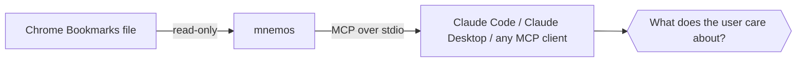

<div align="center">

# 🧠 mnemos

**Your bookmarks are a map of what you value. Let your AI read the map.**

*mnemos* (from the Greek **μνήμη** — memory) is a local, read-only
[MCP](https://modelcontextprotocol.io) server that gives AI assistants access to your
Chrome bookmarks — not as a pile of links, but as a curated signal of what you
consider important, which sources you trust, and which opinions you endorse.

[](https://www.npmjs.com/package/mnemos-mcp)
[](https://github.com/noesis-sol/mnemos/actions/workflows/ci.yml)
[](https://nodejs.org)
[](https://modelcontextprotocol.io)
[]()
[]()

</div>

---

## Why

Every bookmark is a deliberate act: *this mattered enough to keep.* Folder names
are your personal taxonomy. Frequently bookmarked domains are your trusted
sources. Recent additions are what you're thinking about *right now*.

mnemos hands that context to your AI assistant, so instead of generic answers you get:

> *"Based on your bookmarks, you've been deep in agentic engineering lately —
> here's how this connects to the LiveKit material you saved…"*

## How it works



mnemos reads Chrome's `Bookmarks` JSON file directly from disk on every call —
always fresh, no sync, no cache, no writes, no network. It speaks MCP over
stdio, so it works with any MCP client.

## Tools

| Tool | What it tells your assistant |
|------|------------------------------|
| 🔍 `search_bookmarks(query, folder?, limit?)` | Has the user saved material on this topic? Every query word must match the title, URL, or folder path, at the start of a word — `kubernet` finds *Kubernetes*, `ai` doesn't match *Gmail*. |
| 🗂 `list_folders()` | The user's own taxonomy of interests — every folder, with direct and subtree counts. |
| 📁 `list_folder_contents(folder, limit?)` | Everything saved under a topic (whole-word folder matching, subfolders included). |
| 🕐 `recent_bookmarks(limit?)` | What the user is focused on right now, newest first. |
| 🌐 `top_domains(limit?)` | The sources the user trusts and returns to, ranked by bookmark count. |

Every tool that can truncate reports a `total_matches` count, so the assistant
always knows when it is looking at a partial list. Defaults return up to 100
items (hard cap 200; `top_domains` defaults to 25, cap 100).

## Quick start

Requires Node 18+ (macOS, Windows, or Linux). No clone, no setup — `npx` fetches and runs it:

**Claude Code**

```sh
claude mcp add --scope user mnemos -- npx -y mnemos-mcp
```

**Claude Desktop** — add to `~/Library/Application Support/Claude/claude_desktop_config.json`:

```json
{
  "mcpServers": {
    "mnemos": {
      "command": "npx",
      "args": ["-y", "mnemos-mcp"]
    }
  }
}
```

Then ask things like:

- *"Based on my bookmarks, what am I currently interested in?"*
- *"Have I saved anything about MCP servers?"*
- *"Which sources do I trust for finance?"*

## Configuration

| Environment variable | Default | Purpose |
|----------------------|---------|---------|
| `CHROME_PROFILE` | `Default` | Chrome profile directory name (e.g. `Profile 3`) |
| `CHROME_BOOKMARKS_PATH` | — | Absolute path to any `Bookmarks` file; overrides the profile |

> Profiles live in `~/Library/Application Support/Google/Chrome` (macOS),
> `%LOCALAPPDATA%\Google\Chrome\User Data` (Windows), and
> `~/.config/google-chrome` (Linux). Directory names are `Default`,
> `Profile 1`, `Profile 2`, … — **not** the display names you see in
> Chrome's UI.

If the profile has no bookmarks file, mnemos tells the assistant which profiles
do — no cryptic tracebacks.

## Privacy & design

- **Read-only.** mnemos never modifies your bookmarks file.
- **Local-only.** No network calls, no telemetry — data goes from disk to your MCP client and nowhere else.
- **Zero state.** The file is re-read per call, so results always reflect what's in Chrome right now.
- **One file.** The whole server is [`src/index.ts`](src/index.ts) — auditable in five minutes.

## Development

```sh
git clone git@github.com:noesis-sol/mnemos.git && cd mnemos
npm install          # installs deps and builds via the prepare script
npm test             # unit + fixture + protocol tests (node:test, zero extra deps)
npm run build        # recompile after changes
node dist/index.js   # run the server (speaks MCP over stdio)
```

Tests run against a synthetic bookmarks fixture in [`test/fixtures/`](test/fixtures/)
— they never read your real Chrome profile. (Fixtures are injected via the same
`CHROME_BOOKMARKS_PATH` override users can set; new tests should do the same.)
CI runs the suite on macOS, Windows, and Linux across Node 18 and 22.

---

<div align="center">
<sub>Built with the <a href="https://github.com/modelcontextprotocol/typescript-sdk">official MCP TypeScript SDK</a>. Works with Google Chrome on macOS, Windows, and Linux; PRs for other Chromium-based browsers welcome.</sub>
<br>
<sub>MIT © Michail Michailidis</sub>
</div>
